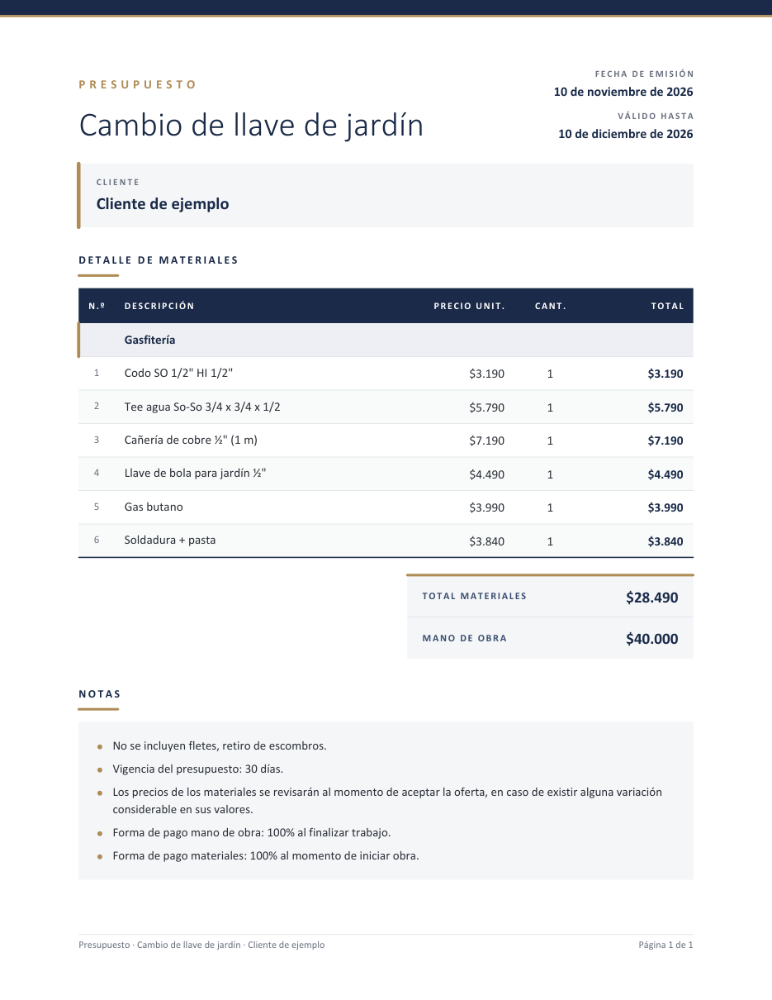

# Creador de presupuestos

Aplicación de escritorio sencilla para **crear, guardar y exportar presupuestos en PDF**, pensada para personas sin experiencia técnica.
Se abre con doble clic y se usa desde el navegador; no necesita internet para funcionar ni depende de servicios externos.



## Funcionalidades

- **Pantalla principal** con todos los presupuestos en una cuadrícula, con buscador por cliente o proyecto.
- **Formulario guiado en 3 pasos**: datos (cliente, fecha, proyecto), materiales y costos, y guardar o crear el PDF.
- **Tabla de materiales** con cálculo automático del total de cada fila, del costo total de materiales y de la mano de obra.
  Acepta precios como `3.190` o `$3190` y cantidades con decimales (`1,5`).
- **Subtítulos opcionales** para agrupar materiales, y botones para reordenar o quitar filas (con «Deshacer»).
- **Guardar**, **Crear PDF** y **Guardar y crear PDF**. El PDF se abre solo y queda en su carpeta.
- **PDF profesional** (tamaño carta): encabezado con fechas de emisión y vigencia, tabla numerada,
  resumen de totales, notas y numeración de páginas.
- **Protección contra pérdida de datos**: aviso de cambios sin guardar, confirmación antes de eliminar
  (los eliminados se mueven a una carpeta, no se borran) y mensajes claros ante cualquier error.

## Instalación (una sola vez)

En el computador donde se usará el programa:

1. Abra **PowerShell** (menú Inicio → escriba «PowerShell» → Enter).
2. Copie y pegue esta línea y presione Enter:

   ```powershell
   irm https://raw.githubusercontent.com/Bastian444/creador-presupuestos/main/install.ps1 | iex
   ```

3. Espere a que diga **«Listo»**. Si aparece una ventana pidiendo permiso para instalar Git o Python, acéptela.

El instalador:

| Paso | Qué hace |
|---|---|
| 1 | Comprueba la conexión a internet. |
| 2 | Revisa si está **Git**; si falta, lo instala (con `winget` o con el instalador oficial). |
| 3 | Revisa si hay **Python 3.10 o superior**; si falta, instala Python 3.12 solo para el usuario actual. |
| 4 | Descarga el programa en `%LOCALAPPDATA%\Programs\CreadorPresupuestos` (o lo actualiza si ya estaba). |
| 5 | Prepara la carpeta de datos en `Documentos\Presupuestos`. |
| 6 | Crea un entorno de Python propio (`.venv`) e instala las dependencias. |
| 7 | Comprueba que todo funcione (crea un PDF de prueba) y deja **«Creador de presupuestos»** en el Escritorio. |

Si algo falla, el instalador explica qué pasó y qué hacer. Se puede ejecutar de nuevo sin problemas.

<details>
<summary>Opciones avanzadas</summary>

Descargando `install.ps1` y ejecutándolo como archivo:

```powershell
powershell -ExecutionPolicy Bypass -File .\install.ps1 -Carpeta "D:\Programas\Presupuestos" -CarpetaDatos "D:\Mis presupuestos"
```

| Opción | Uso |
|---|---|
| `-Carpeta` | Dónde se instala el programa. |
| `-CarpetaDatos` | Dónde se guardan los presupuestos y PDF. |
| `-NoAbrir` | No abre el programa al terminar. |
| `-SinAccesoEscritorio` | No crea el archivo en el Escritorio. |

</details>

## Uso

Doble clic en **«Creador de presupuestos»** en el Escritorio. El programa se abre en el navegador y la ventana negra se cierra sola.
Si ya estaba abierto, solo se abre otra pestaña.

## Actualización

Cuando se publique una nueva versión en GitHub, use cualquiera de estas opciones:

- Doble clic en **`Actualizar Creador de presupuestos.bat`** (dentro de `%LOCALAPPDATA%\Programs\CreadorPresupuestos`), o
- vuelva a ejecutar la misma línea de instalación en PowerShell.

**Las actualizaciones nunca tocan los presupuestos.** Los datos se guardan fuera de la carpeta del programa
(`Documentos\Presupuestos`). Además, esas carpetas están excluidas de Git y la actualización solo reemplaza
los archivos del programa (`git reset --hard`, sin `git clean`).

## Dónde quedan los datos

```
Documentos\Presupuestos\
├── Presupuestos guardados\     ← un archivo .json por presupuesto
│   └── Eliminados\             ← presupuestos eliminados (se pueden recuperar moviéndolos de vuelta)
└── Presupuestos en PDF\        ← los PDF creados
```

Cada `.json` tiene un nombre descriptivo (`2026-11-10 - Cliente - Proyecto.json`) y guarda todos los datos del presupuesto.
El PDF se genera siempre a partir de esa misma información.

## Tecnologías

- **Python 3.10+** con la biblioteca estándar (`http.server`) como servidor local en `127.0.0.1`.
- **[ReportLab](https://www.reportlab.com/opensource/)** para generar los PDF.
- **HTML, CSS y JavaScript** sin frameworks ni dependencias externas para la interfaz.
- **PowerShell** para la instalación y actualización; archivos **.bat** para abrir el programa con doble clic.

## Estructura del proyecto

```
├── app/
│   ├── servidor.py          servidor local y API (guardar, listar, eliminar, crear PDF)
│   ├── almacenamiento.py    lectura y escritura de los .json
│   ├── generar_pdf.py       diseño del PDF (las NOTAS están al inicio de este archivo)
│   ├── config.py            rutas (lee config.local.json si existe)
│   ├── iniciar.py           deja el servidor en segundo plano y abre el navegador
│   ├── verificar.py         prueba que usa el instalador
│   └── web/                 interfaz (index.html, estilos.css, app.js)
├── docs/                    imágenes del README
├── install.ps1              instalador y actualizador
├── Iniciar Creador de presupuestos.bat
├── Actualizar Creador de presupuestos.bat
└── requirements.txt
```

## Desarrollo

```powershell
git clone https://github.com/Bastian444/creador-presupuestos.git
cd creador-presupuestos
python -m venv .venv
.venv\Scripts\python -m pip install -r requirements.txt
.\"Iniciar Creador de presupuestos.bat"
```

Sin `config.local.json`, los datos se guardan dentro de la carpeta del proyecto (ignorada por Git).
El programa se reinicia solo al abrirlo si detecta que el código cambió. Los errores quedan en `app/registro.log`.
